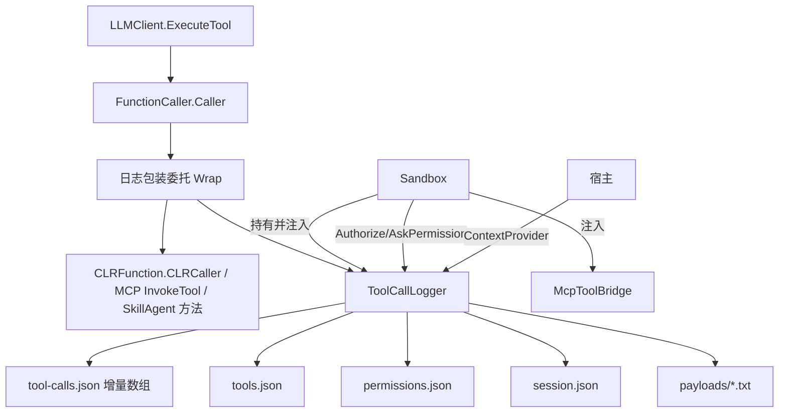

## 产品概述

为 `g:/LLMs/src/Harness`（VB.NET 智能体工具沙箱）新增**详尽的工具调用结构化日志**。所有工具（16 个本地沙箱工具、MCP 服务器桥接的 tool/resource/prompt、Skill 系统的 execute_skill_script / read_skill_file）的每一次执行都被完整记录，以 JSON 数组文件形式写入 sandbox 的 ArtifactFolder（`<workspace>\.harness\`），供后期人工审阅与调试复现。

## 核心功能

- **逐次调用全量留痕**：序号、UTC/本地时间戳、会话耗时刻度、线程、工具名、来源（sandbox/mcp/skill）、MCP 服务器名与原始名、原始入参字典（含类型还原与截断）、声明参数逐项比对（缺失必填/未知参数/是否用默认值）、返回文本全文、返回长度与 SHA256、耗时（Stopwatch 毫秒）、状态（ok/denied/error）、异常类型+消息+堆栈、宿主注入上下文（任务名/轮次）。
- **四类结构化文件**，全部为合法 JSON 数组：222222222111222222222222222222
- `tool-calls.json`：调用流水（主日志，增量追加、崩溃仍合法）
- `tools.json`：注册快照（工具名、描述、参数类型/默认值/是否必填、来源、服务器名、原始名）
- `permissions.json`：权限申请与拒绝事件（操作、目标、请求模式、justification、放行/拒绝）
- `session.json`：会话摘要（工作区、安全策略、起止时间、按工具/状态计数、总耗时、错误清单）
- **超大载荷外置**：结果/入参超过阈值时正文落到 `payloads/NNNN-<tool>.txt`，记录里保留相对路径与截断预览，主 JSON 不被撑爆。
- **宿主上下文注入**：`ToolCallLogger.ContextProvider As Func(Of ToolCallContext)`，宿主可把当前任务名、轮次 id 写进每条记录。
- **零侵入、可关停**：默认开启；`Sandbox.ToolLogEnabled` 可关闭；写盘失败静默降级为内存记录，任何情况下不影响工具本身的执行结果。

## 技术栈

- 语言/框架：VB.NET，net10.0（与 `Harness.vbproj` 一致），Ollama 工程**零改动**
- 序列化：`System.Text.Json`（net10.0 BCL 自带，`JsonSerializerOptions{WriteIndented=True}`，无需改 vbproj 引用）
- 依赖事实：`CLRFunction.GetTarget/GetMetadata/Caller`（`g:/LLMs/src/Ollama/ToolCalls/CLRFunction.vb`）均为 **Public**，可在 Harness 侧手工展开 `AddFunction(Of T)` 的注册过程

## 实现方案

**核心策略：在 Harness 的三个工具注册点，用"带日志的包装委托"替换原委托后再交给 `LLMClient.AddFunction`。**

因为分发漏斗 `FunctionCaller.Caller`（`Ollama/ToolCalls/FunctionCaller.vb:42` 的 `registry(arg.name)(arg)`）是唯一执行点，但其宿主字段 `LLMClient._caller` 为 Private、外部不可达，所以在**注册时**包装是唯一不动 Ollama 就能覆盖全部调用的切入点：

```
' 原先：client.AddFunction(tool, name)   ' → AddFunction(Of T) 内部：AddFunction(handle.GetMetadata, CLRFunction.Caller(obj, handle))
' 改为：
For Each handle In CLRFunction.GetTarget(GetType(T), name)
    Dim meta As FunctionModel = handle.GetMetadata()
    Dim inner As Func(Of FunctionCall, String) = CLRFunction.Caller(tool, handle)
    Call client.AddFunction(meta, ToolLog.Wrap(meta, "sandbox", Nothing, inner))
Next
```

LLMClient 的两条调用路径（DSML 分支 `LLMClient.vb:467` 与主分支 `:521`）都走 `ExecuteTool`，因此均被覆盖。

### 挂接点（3 处，全部在 Harness 内）

1. `Sandbox.vb:228` `RegisterTool(Of T)`：16 个本地工具（read/write/edit/multi_edit/apply_patch/glob/grep/ls/delete/move/shell/ask_user_question/job_start/job_kill/job_list/job_output）
2. `MCP/McpToolBridge.vb:184-185` `Attach`：用 `Registration` 已有的 `ServerName/Kind/OriginalName` 丰富 source 字段
3. `SkillSystem/SkillAgent.vb:273/300`：构造函数内注册，故 logger 通过**新增 Optional 构造参数**传入（不破坏既有调用点）

### 日志文件布局（ArtifactFolder = `.harness`，常量见 `Sandbox.vb:35`）

```
<workspace>\.harness\toolcalls\<sessionId>\
    tool-calls.json     # 主日志：JSON 数组，每次调用一条
    tools.json          # 注册 schema 快照：JSON 数组
    permissions.json    # 权限事件：JSON 数组
    session.json        # 会话摘要（对象）
    payloads\NNNN-<tool>.txt   # 超限的入参/返回正文
```

### 关键机制

- **追加即合法的 O(1) 写入**：文件始终以 `]` 结尾。追加记录时 `Position = Length - 1`（回退那个 `]`），写 `,` + 记录 JSON + `]`，Flush。打开时容错：`]`→回退 1 字节；`[`→原样；残缺尾（`,` 或未闭合）→补 `null]` 后再追加。崩溃也不会留下半截非法文件。
- **线程安全**：`Sandbox.Jobs` 后台任务会并发调工具 → `SyncLock` 保护写盘与序号递增；序号用 `Interlocked.Increment`；`Stopwatch` 计量在锁外。
- **绝不因日志失败工具**：`Wrap` 内部 `Try/Catch` 包住 `inner(fc)`；写盘/建目录异常仅记录到 `logger.LastError` 并置 `IsPersistent=False` 降级为内存记录（仍可通过 `Records` 属性读取）。
- **结果状态判定**：异常→`error`；返回文本匹配 `Error:`/`error:`/`permission denied`/`MCP tool call failed`/`not found` 等已知前缀→`denied`（启发式，记录里同时保留原文供人工判断）；否则 `ok`。**被包装委托的返回值必须原样透传**，不改变 LLM 收到的任何内容。
- **Readonly 策略**：日志属沙箱自身簿记（写在工作区内），仍尝试落盘；创建目录失败即静默降级，不抛异常、不申请权限。

### 性能

- 单次调用额外开销 = 1 次 Stopwatch + 1 次记录序列化 + 1 次 O(1) 文件追加（无全量重写，避免 O(n²)）。
- 结果正文默认全量内联（符合"尽可能多记录"），超过 `ToolLogOptions.MaxInlineChars`（默认 256 KB）才外置到 `payloads\`；SHA256 仅在超过阈值或开启 `HashResults` 时计算。
- 日志器不持有工具实例引用以外的长生命周期对象；payload 文件用 `File.WriteAllText` 一次性写。

## 执行要点（防回归）

- VB 陷阱：Module 成员**不能** `Shared`、默认 `Private`（跨模块用需显式 `Public`）；局部变量不得与类型/属性名仅大小写不同（避开 `Path`/`File`/`Result`/`Math`）；参数名不能是保留字（`[error]` 需方括号）；新类型名避开已有的 `FunctionCall`/`FunctionModel`。
- `Sandbox.RegisterTo` 通过 `MakeGenericMethod` 反射调用 `RegisterTool(Of T)`，改为手工展开注册时**必须保持工具名来自 `handle.GetMetadata().name`（ExportAPI 名）**，与旧行为逐字一致，否则 LLM 侧工具名会变。
- `Sandbox` 目前未实现 `IDisposable`：新增 `Public Sub CloseToolLog()`（落 `session.json`、Flush、关闭句柄），不改动既有生命周期语义；`CloseMcpServers` 已有模式可参照。
- 权限事件埋点只在 `AskPermission`（`Sandbox.vb:359`）与 `AuthorizeEscalation`（`Sandbox.vb:418`）两处 RaiseEvent 前后插入，不改变判定逻辑与返回文本。
- 自测触发真实调用：`LLMClient._caller` 是 Private 字段，测试用 `GetType(LLMClient).GetField("_caller", Instance Or NonPublic)` 反射取到后调其 Public `[Call](FunctionCall)`；构造 `New LLMClient(New OpenAIProvider("http://127.0.0.1:1/", "no-key"), "test")` 仅注册不发请求。

## 架构设计



## 目录结构

```
src/Harness/
├── Logging/
│   ├── ToolCallLog.vb        # [NEW] 数据模型：ToolCallRecord（seq/时间戳/耗时/工具名/source/server/originalName/kind/
│   │                         #        arguments/参数诊断/resultText/resultLength/resultSha/status/error/context）、
│   │                         #       ToolRegistrationRecord、ToolPermissionRecord、ToolSessionSummary、
│   │                         #       ToolCallContext、ToolLogOptions（MaxInlineChars/HashResults/Enabled）、
│   │                         #       ToolCallStatus 与 ToolCallSource 枚举
│   └── ToolCallLogger.vb     # [NEW] 日志器：会话目录创建(wsRoot\.harness\toolcalls\<sessionId>)、
│                             #       Wrap(meta, source, server, inner) 返回包装委托、RegisterTool 快照、
│                             #       LogPermission、Close(写 session.json)、SyncLock 线程安全、
│                             #       JSON 数组增量写入器（回退 ] 追加，崩溃仍合法）、写盘失败降级内存
├── Sandbox.vb                # [MODIFY] 新增 wsLog 字段与 ToolLog/ToolLogEnabled/ContextProvider 属性；
│                             #          RegisterTool 改为手工展开注册并包装；RegisterMcpServers 注入 logger；
│                             #          AskPermission/AuthorizeEscalation 埋权限事件；新增 CloseToolLog()
├── MCP/McpToolBridge.vb      # [MODIFY] 新增 Public Property ToolLog；Attach 时把 c.Invoke 包装后注册，
│                             #          携带 ServerName/Kind/OriginalName
├── SkillSystem/SkillAgent.vb # [MODIFY] 构造新增 Optional toolLog 参数；execute_skill_script 与
│                             #          read_skill_file 两处 AddFunction 改为包装注册
├── test/
│   ├── ToolLogSelfTest.vb    # [NEW] 离线自测：反射 _caller 触发真实调用；校验 4 个文件存在且为合法 JSON 数组、
│   │                         #       字段完整性、错误/拒绝状态、超限外置 payload、并发 4 线程序号唯一、
│   │                         #       尾部残缺文件自动修复
│   └── Program.vb            # [MODIFY] 新增 --toollog 分支并在 --help 中登记
└── Harness.vbproj            # [无需改动]（SDK 风格自动收录 .vb；System.Text.Json 随 net10.0 提供）
```

## Agent Extensions

### SubAgent

- **code-explorer**
- Purpose：实现前复核 `CLRFunction.GetTarget/GetMetadata/Caller` 的精确签名与可见性，以及 `LLMClient._caller` 字段名，避免反射取错
- Expected outcome：确认包装展开写法可编译、反射自测路径可用