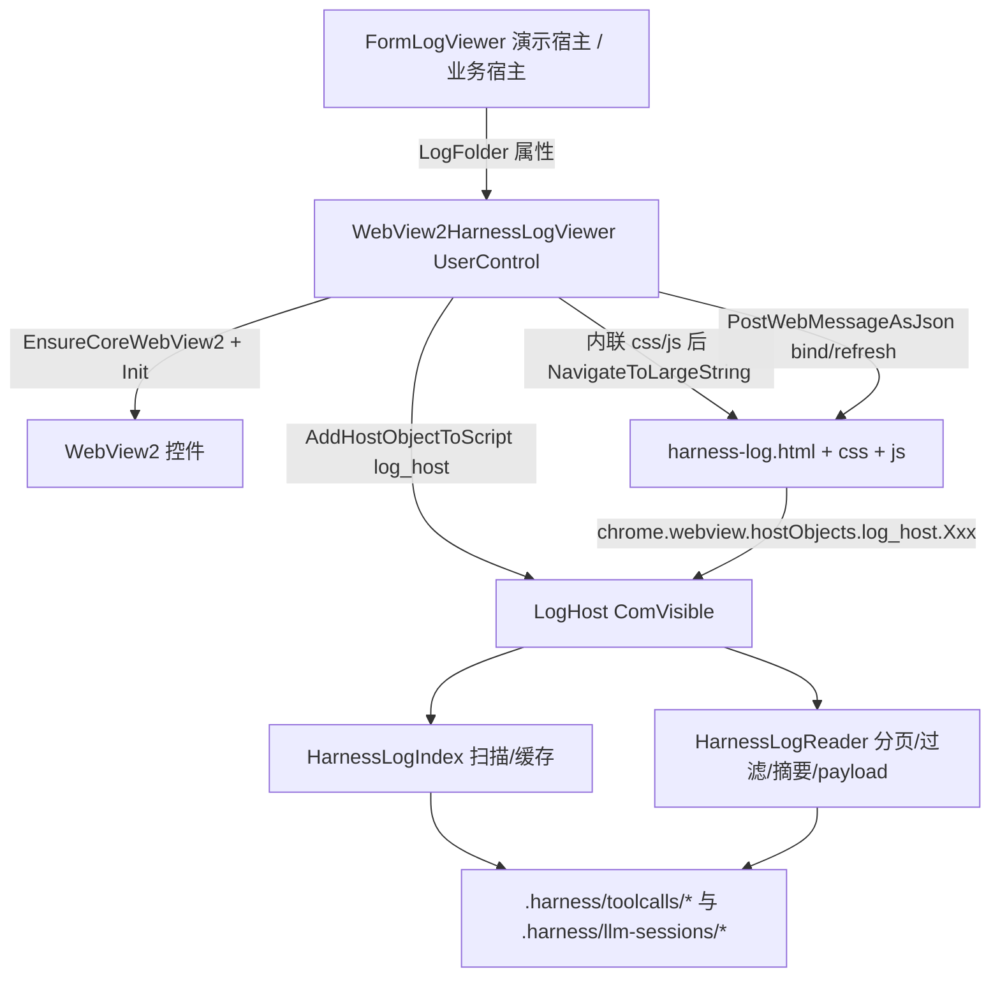

## 产品概述

在 `g:/LLMs/src/WebView2UI/WebView2UI.vbproj` 工程中新增一个可复用的 WinForms UserControl（`WebView2HarnessLogViewer`），通过 WebView2 承载内嵌的 HTML+CSS+JS 单页应用，用于查看前两轮实现的 Harness 工具调用日志与 Ollama 会话日志（位于 `G:\OmicsWorks\test\smoke_20261017\.harness`）。所有 JSON 解析、分页、过滤均在 VB 宿主侧完成，网页端只做渲染，保证 5.7MB 的 turns.json 也能秒开。

## 核心功能

- **会话列表 + 会话概览**：扫描 `.harness\toolcalls\*` 与 `.harness\llm-sessions\*`，列出全部会话（id/类型/模型或工作区/时间/条数/状态徽章）；选中后展示会话摘要：调用次数、状态分布、按工具统计、token 与缓存命中、错误清单、权限事件数、各日志文件清单，并可跳转到互相指认的关联会话（`llmLogFolder` / `harnessLogFolder`）。
- **对话轮次查看**：逐 turn → round 树状展开，展示思考全文、正文、首 token 延迟、chunk 数、流式耗时、每轮完整请求消息（system/user/assistant/tool，含 toolCalls 与 toolCallId）、DSML 兜底标记、本轮 usage 与失败原因。
- **工具调用明细 + payload 原文**：表格 + 详情抽屉，展示工具名、调用 id、入参、返回全文（或预览）、耗时、来源（sandbox/mcp/skill、registry/tool_invoke/missing）、参数诊断（缺失必填/未知参数/默认值）、异常类型与堆栈；被外置的正文可通过 payload 弹窗分片读取 `payloads\*.txt` 原文。
- **权限事件**：每次权限申请的操作、目标、是否在工作区内、请求模式（workspace-write / danger-full-access）、模型给出的 justification、放行或拒绝及原因。
- **用量统计**：每轮 prompt/completion token 堆叠柱图 + 缓存命中率折线（内联 SVG 手绘，无外部依赖），累计用量与命中汇总。
- **搜索过滤 + 原始 JSON**：服务端按工具名、状态、来源、关键字、turn/round 序号过滤后分页下发；任意数组文件可直接查看美化后的原始 JSON（超长截断并标注），`rscript\*.log` 等纯文本亦可查看。
- **宿主只读传入**：控件暴露 `Public Property LogFolder As String`，仅由宿主指定，控件 UI 内不可修改；日志根目录缺失或无会话时显示空状态而非异常。

## 技术栈

- 语言/框架：VB.NET，`net10.0-windows`（与 `WebView2UI.vbproj` 一致，UseWindowsForms + UseWPF，MyType=WindowsForms，`GenerateDocumentationFile=True` → Public 成员必须写 XML 注释）
- UI 承载：WinForms `UserControl` + `Microsoft.Web.WebView2 1.0.4258.31`，沿用工程既有 `WebViewLoader`（虚拟域名 + `AddWebResourceRequestedFilter` 返回内存流）
- 前端：原生 HTML + CSS + JavaScript（零外网、零 CDN、无框架），三个源文件经 `EmbeddedResource` 嵌入，加载时替换占位注释符内联进单个文档
- 数据解析：`System.Text.Json`（`JsonDocument`/`JsonElement`）+ 宿主持有的 LRU 文档缓存（按字节上限淘汰，`JsonDocument` 需 Dispose）
- 互操作：宿主→网页 `CoreWebView2.PostWebMessageAsJson`；网页→宿主 `AddHostObjectToScript("log_host", …)`，host object 带 `<ClassInterface(ClassInterfaceType.AutoDual)> <ComVisible(True)>`，全部方法参数与返回均为 `String`
- 新增依赖：无（Core / JSON / markdown / Ollama 已引用，System.Text.Json 随框架提供）

## 实现方案

**核心策略：重计算、轻渲染。** 全部文件扫描、JSON 解析、过滤、分页、文本切片在 VB 宿主侧完成，host object 每次只把一页小数据（默认 30 条）或单个 turn/round 以 JSON 字符串交给网页，避免把 5.7MB 的 turns.json 丢给 JS 解析导致卡死。

### 架构



### host object 契约（`LogHost.vb`，全部 String 进出）

| 方法 | 作用 |
| --- | --- |
| `ListSessions()` | 返回 `{root, sessions:[{kind, sessionId, folder, mtime, files:[{name,size}], summary}]}`，summary 直接取 session.json 解析结果 |
| `OpenSession(kind, sessionId)` | 返回 `{ok, files:[{name,size,records}], summary, linked}`（linked 为关联会话） |
| `Records(name, offset, limit, filterJson)` | 数组文件分页 + 服务端过滤，返回 `{total, offset, limit, items[]}`；**turns.json 只下发摘要**（剥离 rounds/messages） |
| `Turn(turnSeq)` | 返回单个完整 turn（含 rounds 与 messages） |
| `Round(turnSeq, roundSeq)` | 返回单个 round（含 requestMessages） |
| `Payload(relativePath, offset, limit)` | 读取 `payloads\*.txt` 切片 |
| `RawFile(name, maxChars)` | 原始 JSON 美化文本，超长截断并标注 |
| `TextFile(name)` | `rscript\*.log` 等纯文本分片 |


所有方法异常统一返回 `{"error": "..."}`，网页渲染错误条而非白屏。

### 关键机制

- **LRU 文档缓存**：`Dictionary(Of String, KeyValuePair(Of JsonDocument, Long))` + 累计字节上限（默认 48MB），超限淘汰最久未用并 Dispose；翻页/过滤不重复解析 turns.json。
- **安全边界**：host object 只接受会话目录内的相对文件名（白名单：session.json / tool-calls.json / tools.json / permissions.json / turns.json / usage.json / messages.json / payloads\NNNN.txt），拒绝 `..`、绝对路径与未知文件名，防止网页侧越权读盘。
- **过滤服务端做**：按 tool、status、source、keyword、turnSeq 范围逐条扫 JsonElement，命中后分页；keyword 对 arguments/result 预览做大小写不敏感包含匹配。
- **前端性能红线**：单页 30/50/100 可切；列表行默认折叠、详情按需展开；`<pre>` 超 500 行只渲染前 N 行并提示；payload 弹窗分片加载（默认 64KB/片）。
- **零外网**：禁用 CDN 与外链字体，图表用内联 SVG 手绘（堆叠柱 + 折线），确保离线可用。
- **降级**：LogFolder 不存在/无会话 → 页面空状态提示；WebView2 初始化失败沿用 `WebViewLoader` 兜底，并向宿主暴露 `LastError` 与 `InitializationFailed` 事件。
- **filter 冲突规避**：`WebViewLoader.NavigateToLargeString` 的 filter 是进程级全局，故本控件只在自身 `CoreWebView2InitializationCompleted` 中调用一次，并在 XML 注释中注明"同一进程内不宜与 WebView2LLMUI 同时初始化"。

### 性能

- 单页下发数据量 = 30 条记录（turns 为摘要），与文件总大小解耦；翻页仅一次 JSON 序列化 + 一次 PostWebMessage。
- 5.7MB turns.json 只在首次 OpenSession/Records 时解析一次（JsonDocument 解析约百毫秒级），后续走缓存。
- 大文本（请求消息、result）走 payload 分片，不做全量字符串拼接下发。

## 实现要点（防回归）

- 不改 `HtmlUiResource.resx`、不改既有 `index.html`、不改 `WebView2LLMUI.vb` 行为；新资源用 vbproj 显式 `EmbeddedResource Include="Logs\*"` + `LogicalName=WebView2UI.Logs.%(Filename)%(Extension)`。
- VB 陷阱：Module 成员不能 `Shared`、默认 `Friend`（新模块写 `Public Module`）；局部变量不得叫 `file`/`path`/`next`/`step`/`call`/`result`；`[error]`、`[Default]` 加方括号；类内有 `Sha256` 成员时 `SHA256.Create()` 全限定；`Public` 成员写 XML 注释（GenerateDocumentationFile=True 下保持 0 警告）。
- 不与 sciBASIC 的 `...application.json.Javascript` 同时 Imports（`JsonElement` 会 BC30561 歧义），只用 `System.Text.Json`。
- 控件可复用：所有会话状态都在 `HarnessLogIndex` 实例内，`LogFolder` setter 重建索引并通知页面重绑，不依赖任何全局静态。

## 目录结构

```
src/WebView2UI/
├── WebView2HarnessLogViewer.vb         # [NEW] UserControl：WebView2 dock fill、LogFolder 属性（set 时重建索引+重绑）、
│                                       #        Load→WebViewLoader.Init；CoreWebView2InitializationCompleted→建 LogHost、
│                                       #        AddHostObjectToScript("log_host")、内联 css/js 后 NavigateToLargeString、
│                                       #        拦截 file:// 导航；PostWebMessageAsJson 下发 bind；LastError/InitializationFailed
├── WebView2HarnessLogViewer.Designer.vb# [NEW] InitializeComponent（WebView2 控件，照 WebView2LLMUI.Designer.vb）
├── WebView2HarnessLogViewer.resx       # [NEW]
├── Logs/
│   ├── HarnessLogIndex.vb              # [NEW] 扫描 .harness、发现两类会话、文件清单与大小、LRU JsonDocument 缓存、
│   │                                    #        会话目录路径白名单校验
│   ├── HarnessLogReader.vb             # [NEW] 分页+过滤、turns 摘要、Turn/Round 单取、Payload/RawFile/TextFile 分片
│   ├── LogHost.vb                      # [NEW] ComVisible+AutoDual host object（薄封装，String 进出，异常转 {"error":...}）
│   └── LogViewerSelfTest.vb            # [NEW] --selftest 无头自测：读真实 smoke_20261017 日志，断言数量/分页/过滤/payload
├── Logs/
│   ├── harness-log.html                # [NEW] 页面骨架：顶栏（标题+状态）+ 侧栏会话列表 + 页签（概览/对话/工具/权限/消息/用量/工具表/原始/文本）
│   │                                    #        + 详情抽屉 + payload 模态框 + 错误条 + <!--@css--> <!--@js--> 占位
│   ├── harness-log.css                 # [NEW] 与 index.html 同设计语言（CSS 变量 #2563EB/#F7F8FA/#FFF/#1F2937/#6B7280/#E5E7EB）
│   └── harness-log.js                  # [NEW] 渲染引擎：host 调用封装、会话列表、页签切换、分页表格、turn/round 树、
│                                       #        SVG 堆叠柱+折线、payload 弹窗、过滤表单、原始 JSON 美化、错误条
├── FormLogViewer.vb / .Designer.vb / .resx   # [NEW] 演示宿主：顶部工具条（路径框+浏览+刷新，属宿主 chrome）+ 控件 dock fill，
│                                       #        默认 LogFolder = G:\OmicsWorks\test\smoke_20261017\.harness
├── My Project/Application.Designer.vb  # [MODIFY] OnCreateMainForm 按 --logs 选 FormLogViewer（最小 3 行改动）
└── WebView2UI.vbproj                   # [MODIFY] 新增 EmbeddedResource Include="Logs\*" + LogicalName
```

## 关键代码结构

```
' LogHost.vb —— 网页侧唯一的调用入口
<ClassInterface(ClassInterfaceType.AutoDual)>
<ComVisible(True)>
Public Class LogHost
    Public ReadOnly Property Root As String
    Public Function ListSessions() As String          ' {root, sessions:[...]}
    Public Function OpenSession(kind As String, sessionId As String) As String
    Public Function Records(name As String, offset As Integer, limit As Integer, filterJson As String) As String
    Public Function Turn(turnSeq As Integer) As String
    Public Function Round(turnSeq As Integer, roundSeq As Integer) As String
    Public Function Payload(relativePath As String, offset As Integer, limit As Integer) As String
    Public Function RawFile(name As String, maxChars As Integer) As String
    Public Function TextFile(name As String, offset As Integer, limit As Integer) As String
End Class

' WebView2HarnessLogViewer.vb —— 宿主侧最小 API
Public Class WebView2HarnessLogViewer
    Inherits UserControl
    Public Property LogFolder As String                ' 仅宿主设置；set 时重建索引并通知页面重绑
    Public ReadOnly Property Sessions As Integer
    Public ReadOnly Property LastError As String
    Public Event InitializationFailed(message As String)
End Class
```

## 验证方式（无 GUI 环境可执行）

1. `dotnet build WebView2UI.vbproj -c Debug` → 0 警告 0 错误。
2. `dotnet bin\Debug\net10.0-windows\WebView2UI.dll --selftest`：无头跑 `LogViewerSelfTest`，直接读 `G:\OmicsWorks\test\smoke_20261017\.harness`，断言 4 个会话被发现、tool-calls 41/55 条、permissions 30 条、usage 40 条、messages 96 条、tools 18 条、turns.json 分页与摘要条数正确、`Turn(seq)` 可取到完整 rounds、payload 切片长度正确、RawFile 截断标记、过滤（tool=multi_edit 得 6 条、status=error 得 6 条）全部命中，输出通过/失败计数并以退出码反馈。
3. `dotnet WebView2UI.dll --logs`（有桌面会话时）人工核对界面：会话列表、对话树、工具明细、payload 弹窗、用量曲线、原始 JSON。

## 设计风格

采用「深色控制台 + 浅色数据面板」的双主题结构：顶栏与侧栏会话列表使用深色（#0F172A / #1E293B）营造工具感与聚焦，主内容区使用浅色面板（#FFFFFF / #F7F8FA）保证长文本与代码的可读性。整体沿用工程既有 `index.html` 的设计语言（CSS 变量、圆角卡片、轻阴影、Segoe UI），数据与代码区块统一 Consolas 等宽字体并带行号感的分隔线。

## 页面布局（自上而下的区块）

1. **顶栏**：左侧标题「Harness 日志查看器」+ 当前根目录（只读展示）；右侧状态点（已连接/错误）、刷新按钮、错误条容器。
2. **侧栏（280px 可折叠）**：搜索框 + 两类分组（toolcalls / llm-sessions），每个会话一张卡片显示 id、模型或工作区、起止时间、调用/轮次数量与状态徽章；当前选中卡片高亮并显示左侧蓝色指示条。
3. **页签栏**：概览 / 对话 / 工具调用 / 权限 / 消息 / 用量 / 工具表 / 原始 JSON / 文本日志；页签下方为该页的过滤条（工具名、状态、来源、关键字、序号范围）与分页控件（30/50/100 + 上一页/下一页 + 总数）。
4. **概览页**：4 张 KPI 卡（调用数、状态分布、token 合计、耗时）+ 按工具统计横向条形 + 错误清单列表 + 文件清单表 + 关联会话跳转。
5. **对话页**：turn 手风琴（序号、时间、状态、轮次、耗时、prompt 摘要）→ 展开后 round 卡片（首 token、chunk 数、流式耗时、DSML 徽章、usage）→ 每轮「思考」「正文」「请求消息」三个可折叠块，消息按角色着色（system 灰、user 蓝、assistant 绿、tool 橙）。
6. **工具调用页**：分页表格（seq、turn/round、工具名、来源徽章、状态徽章、耗时、结果预览）；点击行弹出右侧详情抽屉，展示完整入参（键值表 + 原始 JSON）、参数诊断、完整返回或 payload 入口按钮、异常堆栈。
7. **权限页 / 消息页**：同为分页表格；权限页突出 requestedPermission 与 justification 以及 granted 绿/红徽章；消息页按角色标签着色。
8. **用量页**：内联 SVG 堆叠柱图（每轮 prompt+completion）+ 缓存命中率折线叠加，下方明细表。
9. **工具表页 / 原始 JSON 页 / 文本日志页**：工具表为 schema 表（名称、来源、参数类型/必填/默认值）；原始 JSON 页为文件选择器 + 美化后的 `<pre>`（超 2000 字符截断并提示）；文本页读取 `rscript\*.log`。
10. **payload 模态框**：居中大模态框，显示文件名、长度、sha256、当前分片范围与上/下一分片按钮，内容为等宽 `<pre>`。

## 交互与动效

- 页签切换、手风琴展开、抽屉滑入均使用 160ms ease-out 过渡；表格行 hover 高亮；按钮 hover 加深一档。
- 所有网络请求（host object 调用）期间在顶栏显示细进度条；失败时顶部滑出错误条，5 秒后自动收起。
- 侧栏会话卡片支持键盘上下选择；表格支持点击表头排序（客户端对当前页排序）。

## 响应式

控件宽度小于 900px 时侧栏自动折叠为图标条（点击展开浮层）；小于 640px 时页签横向滚动、表格隐藏次要列（保留 seq/工具/状态/耗时），保证在窄面板中仍可用。

## Agent Extensions

### SubAgent

- **code-explorer**
- Purpose：实现前复核 `WebViewLoader.NavigateToLargeString` 在同一进程内被两个控件调用时的进程级 filter 冲突行为（决定控件初始化顺序与规避方式）；并核对 `index.html` 中 `window.chrome.webview` 消息监听与 host object 调用约定（是否使用 `chrome.webview.hostObjects.sync`），使新页面完全沿用既有互操作写法
- Expected outcome：拿到可照抄的 JS 互操作片段、确认 filter 冲突的规避顺序，避免两个 WebView2 控件互相抢资源过滤器