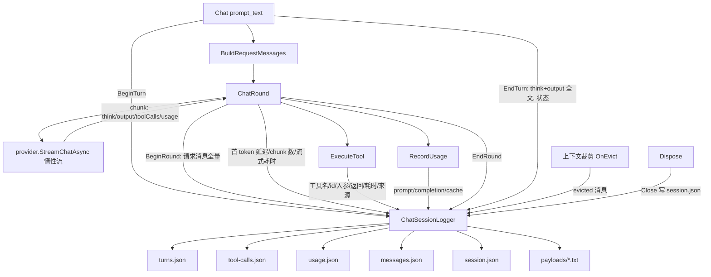

## 产品概述

为 `g:/LLMs/src/Ollama/Ollama.vbproj`（统一 LLM 客户端工程）新增**会话级结构化日志**。一次 `LLMClient.Chat()` 调用的全过程——用户提问、每一轮发给模型的完整消息、模型的思考（reasoning）与正文、触发的工具调用及其返回、每轮 token 用量、网络异常与重试、上下文裁剪——全部以 JSON 数组文件落盘，供事后人工审阅与 Agent 调试复现。

采用**显式启用**：不传日志目录、不注入日志器时不写盘、零开销，既有引用 Ollama 的工程（Harness、DevAgent 等）行为完全不变。启用后与上一轮做的 Harness 工具调用日志**共享 sessionId**，两边文件可按会话 id 与调用序号对账。

## 核心功能

- **会话（session）**：一次客户端实例生命周期一份 `session.json`——会话 id、模型、端点、system prompt、温度/最大轮次、启动与结束时间、总轮次/总工具调用/累计 token、错误清单、上下文裁剪事件、各日志文件路径。
- **轮次（turn）**：每次 `Chat()` 一条 `turns.json` 记录——用户提问全文、请求选项快照、嵌套的每一轮（round）、最终 think 与 output 全文、结束状态（ok / max_rounds_exceeded / failed）、总耗时；网络异常逐条记录（轮序号、异常类型、消息、是否重试）。
- **轮（round）**：每轮一次模型请求——完整请求 messages（含 system prompt、历史、工具结果，超长外置）、首 token 延迟、chunk 数、流式耗时、think 与 output 增量全文、模型请求的工具调用（id/名称/参数）、是否走了 DSML 文本兜底、本轮 usage。
- **工具调用（tool-calls）**：每次 `ExecuteTool` 一条——工具名、调用 id、入参、返回全文、耗时、来源（注册表 / 外部 tool_invoke / 未注册）、是否 DSML 包裹、异常类型与堆栈。
- **用量（usage）**：每请求一条——prompt / completion / 缓存命中 / 未命中 token、命中率、模型、时间戳、会话累计值。
- **消息流水（messages）**：进入会话的每条消息（system/user/assistant/tool，含 toolCalls 与 toolCallId）按序记录，形成完整对话账本。
- **超长文本外置**：请求消息、think/output、工具结果超过阈值时写入 `payloads\NNNN-<name>.txt`，记录里保留长度、sha256、预览与相对路径。
- **容错**：日志写盘失败静默降级为内存记录，绝不影响 `Chat` 的返回值与异常传播；增量追加保证文件任何时刻都是合法 JSON 数组，进程被杀也不留半截文件。

## 技术栈

- 语言/框架：VB.NET，`net10.0`（`Ollama.vbproj` 单 TFM，RootNamespace=Ollama，`GenerateDocumentationFile=True` → 新增 Public 成员必须写 XML 注释）
- 序列化：`System.Text.Json`（net10.0 内置），`JsonSerializerOptions{WriteIndented=True, DefaultIgnoreCondition=WhenWritingNull, Encoder=JavaScriptEncoder.UnsafeRelaxedJsonEscaping}`，与 Harness 侧日志保持同一风格（避免 `<｜｜DSML｜｜...>`、`<think>` 等标记被转义成 `\u003C`）
- 依赖：无新增（Core + JSON-netcore5 已有）

## 实现方案

**核心策略：在 `LLMClient` 的会话主链路上做"观测式埋点"，所有写盘收敛到一个 `ChatSessionLogger`；未启用时全部埋点为空操作。**

链路与挂点（行号见 `g:/LLMs/src/Ollama/LLMClient.vb`）：



**启用方式（显式）**

1. 构造追加参数：`Sub New(..., Optional logFolder As String = Nothing, Optional logOptions As ChatSessionLogOptions = Nothing)`；
2. 或事后启用：`Public Function EnableSessionLog(folder As String, Optional options As ChatSessionLogOptions = Nothing) As LLMClient`；
3. 只读属性 `Public ReadOnly Property SessionLog As ChatSessionLogger`（未启用时返回 Nothing，所有埋点走 `If _sessionLog IsNot Nothing` 短路）。

**为什么不动 `ILLMProvider`**：`StreamChatAsync` 返回的 `IEnumerable(Of ChatResponseChunk)` 是惰性 Iterator，首 token 延迟 / chunk 数 / 流式耗时在 `ChatRound` 的 `For Each` 里测量即可，无需改 provider 接口与两个 provider 实现。

**与 Harness 联动**：`ChatSessionLogger` 暴露可写 `Public Property SessionId`（默认 `yyyyMMdd-HHmmss-xxxxxx` 自动生成）。`Sandbox.RegisterTo(client)` 中：

- 若 `client.SessionLog IsNot Nothing` → 令两侧共用 Harness 的 `wsLog.SessionId`（Ollama 侧目录名即该 id），并在 `session.json` 里记录 `harnessToolLog`（Harness 日志目录）实现双向指路；
- 新增 `Public Property LlmSessionLogging As Boolean`（默认 True）与可选 `llmSessionFolder`，未启用时由 Sandbox 主动 `client.EnableSessionLog(IO.Path.Combine(wsRoot, ArtifactFolder, "llm-sessions", wsLog.SessionId))`，并把 sessionId 对齐。Harness 侧 `ToolCallLogger` 记录里同时写入 `llmSessionId` 字段。

**上下文裁剪事件**：`ChatContextMemory.OnEvict As Action(Of List(Of ChatMessage))`（`ChatContextMemory.vb:46`）全仓库目前无人赋值（已 grep 确认）。启用日志时 LLMClient 挂一个"先记录再链式调用宿主原委托"的包装；若宿主在启用之后覆盖 `OnEvict`，日志侧会失效——在 XML 注释中显式说明，并在 Harness 侧不用该属性以免冲突。

### 性能与开销

- 未启用：仅一次 `Nothing` 判断，无分配、无写盘。
- 启用后单次请求额外开销 = 若干 Stopwatch + 每轮一次记录序列化 + 一次 O(1) 文件追加（**回退 1 字节覆盖结尾 `]`**，不做全量重写，避免 O(n²)）。
- 请求 messages 全量只在 `CaptureRequestMessages=True`（默认 True）时序列化，且单条消息超过 `MaxInlineMessageChars`（默认 32 KB）即截断外置，避免长会话把 JSON 撑爆。
- 逐 chunk 全量转储（`CaptureChunks`）默认 **False**，需要 debug 流式拼装时才开。
- 线程安全：`SyncLock` 保护写盘与序号，`Interlocked` 递增 seq；`Stopwatch` 计量在锁外。

## 执行要点（防回归）

- **行为零变化**：不改动 Console 输出、`LLMsResponse` 返回值、`MaxTryRunException` 抛出路径、异常吞掉重试的逻辑；`ExecuteTool` 只在外部包一层计时与记录，返回值原样透传，异常用 `ExceptionDispatchInfo.Capture(...).Throw()` 原样重抛。
- **日志绝不抛**：建目录/序列化/写盘统一 Try-Catch，失败置 `LastError` 并降级为内存记录（`Persistent=False`）。
- **增量文件合法性**：复用 Harness 验证过的 `JsonArrayAppender` 写法——文件恒以 `]` 结尾，追加时回退 1 字节覆盖；打开时修尾（`]`→回退 1、`[`→原样、`,`/空白→补 `null]`、其它→补 `]`）；`Append` 必须 `SyncLock`（Harness 并发实测出现过以逗号开头的非法文件）。
- VB 陷阱：Module 默认 **Friend**（`CLRFunction` 前车之鉴）→ 新模块一律写 `Public Module`；`SHA256.Create()` 会被同类 `Sha256` 成员遮蔽 → 全限定 `System.Security.Cryptography.SHA256.Create()`；局部变量不得叫 `file`/`path`（遮蔽 `File`/`Path`）；`[error]`/`[call]`/`[Default]` 保留字加方括号；`System.Text.Json.JsonElement` 与 sciBASIC 的 JsonElement 不能同时 Imports（本工程用 System.Text.Json，未引入 sciBASIC Javascript 命名空间）。
- `ChatUsageRecord.HitRate/HasCacheStats` 是只读属性，序列化时不会被写出 → 用量记录另建独立的快照模型，逐字段落盘（不直接序列化 `ChatUsageRecord`）。
- `GenerateDocumentationFile=True` → 所有新增 Public 类型/成员写 XML 注释，保证 0 警告。

## 架构设计

```
ChatSessionLogger（每 LLMClient 一个会话）
  ├─ JsonArrayAppender(turns.json)     增量追加
  ├─ JsonArrayAppender(tool-calls.json)
  ├─ JsonArrayAppender(usage.json)
  ├─ JsonArrayAppender(messages.json)
  ├─ PayloadWriter（payloads\*.txt）
  └─ session.json（重写式：元信息 + 事件 + 收尾摘要）
        ↑
   LLMClient 埋点（Chat / ChatRound / ExecuteTool / RecordUsage / OnEvict / Dispose）
        ↑
   Harness.Sandbox（共享 sessionId、可选自动启用、双向路径指路）
```

## 目录结构

```
src/Ollama/
├── Logging/
│   ├── ChatSessionLog.vb        # [NEW] 数据模型（全部 Public + XML 注释）：
│   │                            #   ChatSessionLogOptions（Enabled/MaxInlineChars/MaxInlineMessageChars/
│   │                            #     PreviewChars/CaptureRequestMessages/CaptureChunks/SpillPayloads/WriteIndented）
│   │                            #   ChatSessionRecord（sessionId/model/endpoint/systemMessage/temperature/maxRounds/
│   │                            #     启动与结束时间/统计/事件/文件路径/harnessToolLog）
│   │                            #   ChatTurnRecord（seq/prompt/options 快照/rounds[]/think/output/status/duration）
│   │                            #   ChatRoundRecord（seq/请求 messages[]/firstTokenMs/chunkCount/streamMs/
│   │                            #     think/output/requestedToolCalls[]/dsmlFallback/usage/error）
│   │                            #   ChatToolCallRecord（seq/turnSeq/roundSeq/name/callId/arguments/result/
│   │                            #     resultLength/resultSha256/resultPayloadFile/durationMs/source/dsmlWrapped/error）
│   │                            #   ChatUsageRecord2（prompt/completion/cacheHit/cacheMiss/hitRate/cumulative/model/time）
│   │                            #   ChatMessageRecord（seq/role/content/toolCalls/toolCallId/length/payloadFile）
│   │                            #   ChatSessionEvent（kind: "evict"/"error"/"retry"/"max_rounds"/"enable"，附带摘要）
│   │                            #   Public Module ChatLogText（状态与来源常量：ok/failed/max_rounds_exceeded、registry/tool_invoke/missing）
│   ├── JsonArrayAppender.vb     # [NEW] Friend Class：追加即合法的 JSON 数组写入器（回退覆盖结尾 ]、打开时修尾、
│   │                            #       Append 内 SyncLock、写坏置 Broken、Close 释放句柄）
│   └── ChatSessionLogger.vb     # [NEW] Public Class：会话目录创建、BeginTurn/EndTurn、BeginRound/EndRound、
│                                #       LogToolCall、LogUsage、LogMessage、LogEvent、Flush、Close（写 session.json）、
│                                #       文本截断外置与 sha256、SyncLock 线程安全、写盘失败降级内存（Records/Turns 可查）
├── LLMClient.vb                 # [MODIFY] 新增 _sessionLog 字段与 SessionLog 只读属性、构造追加 Optional logFolder/logOptions、
│                                #          EnableSessionLog()；Chat 埋 Begin/EndTurn 与重试异常、MaxTryRunException；
│                                #          ChatRound 埋请求消息/首 token/chunk 数/流式耗时/think+output/DSML 标记/round 结束；
│                                #          ExecuteTool 埋工具调用明细（含来源与异常）；RecordUsage 埋用量；
│                                #          启用时挂 OnEvict 记录裁剪事件并链式调用宿主原委托；Dispose 关闭日志
├── test/
│   ├── SessionLogSelfTest.vb    # [NEW] 离线自测：假 ILLMProvider（Yield think/output/toolCalls/usage chunk）驱动
│   │                            #       Chat；覆盖 5 个文件均为合法 JSON 数组、字段完整性、工具调用链路、
│   │                            #       DSML 兜底路径、网络异常重试、max rounds、超长外置 payload、
│   │                            #       未启用时零写盘、OnEvict 事件、Disable 后 session.json 收尾
│   └── Program.vb               # [MODIFY] 新增分支跑会话日志自测（默认仍跑原有持久化 demo，保持向后兼容）
└── Ollama.vbproj                # [无需改动]（SDK 风格自动收录 .vb；System.Text.Json 随 net10.0 提供）

src/Harness/
└── Sandbox.vb                   # [MODIFY] 联动：新增 LlmSessionLogging 开关与可选目录；RegisterTo 时若
                                 #          client.SessionLog 已存在则对齐 sessionId，否则按 .harness\llm-sessions\<id>
                                 #          主动 EnableSessionLog 并在两侧记录对方的日志目录
```

## 关键代码结构

```
' Logging/ChatSessionLogger.vb —— 对 LLMClient 暴露的最小 API（其余为内部记账）
Public Class ChatSessionLogger
    Public Sub New(logFolder As String, model As String, Optional endpoint As String = Nothing,
                   Optional options As ChatSessionLogOptions = Nothing)
    Public Property SessionId As String           ' 可写：Harness 用它对齐两侧日志
    Public ReadOnly Property Folder As String
    Public ReadOnly Property Options As ChatSessionLogOptions
    Public ReadOnly Property Persistent As Boolean
    Public ReadOnly Property LastError As String
    Public Property HarnessLogFolder As String    ' 交叉引用：Harness 工具日志目录
    Public Function BeginTurn(prompt As String, req As ChatRequestOptions) As ChatTurnRecord
    Public Function BeginRound(turn As ChatTurnRecord, req As ChatRequestOptions) As ChatRoundRecord
    Public Sub EndRound(round As ChatRoundRecord, think As String, output As String,
                        Optional usage As ChatUsage = Nothing, Optional errorMessage As String = Nothing)
    Public Sub EndTurn(turn As ChatTurnRecord, response As LLMsResponse, status As String)
    Public Function LogToolCall(turn As ChatTurnRecord, round As ChatRoundRecord,
                                name As String, callId As String, arguments As Dictionary(Of String, String),
                                source As String, dsmlWrapped As Boolean, invoke As Func(Of String)) As String
    Public Sub LogUsage(usage As ChatUsage, model As String)
    Public Sub LogMessage(msg As ChatMessage)
    Public Sub LogEvent(kind As String, summary As String, Optional detail As String = Nothing)
    Public Sub Flush()
    Public Sub Close()
End Class

' LLMClient 侧新增（显式启用，未启用时 SessionLog 为 Nothing）
Public ReadOnly Property SessionLog As ChatSessionLogger
Public Function EnableSessionLog(folder As String,
                                 Optional options As ChatSessionLogOptions = Nothing) As LLMClient
```

## Agent Extensions

### SubAgent

- **code-explorer**
- Purpose：实现前复核 `ChatContextMemory.OnEvict` 的赋值时机与 `EnqueueAsync`/`Trim`/`Compress` 调用点，确认"链式包装"不会与宿主（MemoryPersistsStorage）冲突；并复核 `OllamaProvider.vb` 的 `StreamChatAsync` 惰性语义，确保首 token 延迟的测量位置正确
- Expected outcome：拿到精确的挂点行号与委托签名，避免埋点落在错误位置或覆盖宿主回调