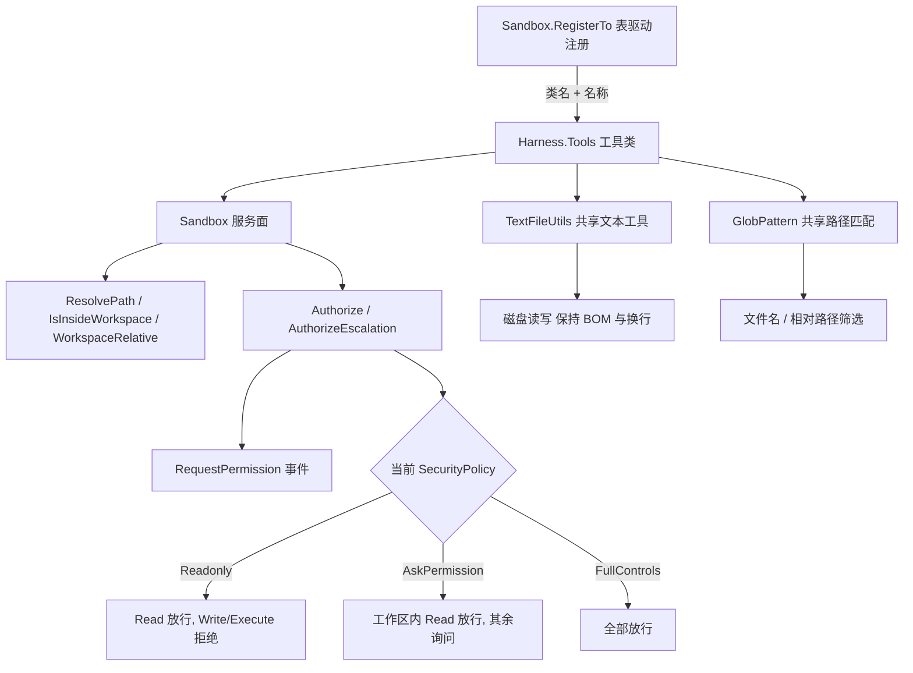

## Product Overview

为已有的文件沙箱工具集补齐"探索—批量修改—清理"三类基础能力，并强化搜索工具的可用性，让 agent 能够独立完成脚本运行与代码开发工作。

## Core Features

### 1. 目录查看工具（ls）

让 agent 看得到目录结构。目前搜索工具只返回文件、不返回目录，在只读策略下外部命令又被禁止，agent 完全无法获知某目录下有哪些子目录。新增工具以文本行形式列出指定目录的子目录与文件（子目录带目录标记），支持查看若干层深度的结构；路径参数相对工作区解析。

### 2. 批量修改工具（multi_edit）

对同一个文本文件一次性做多处字面替换。现有单点替换工具要求每处单独调用且每处内容必须唯一，改一个签名或重命名一个类型往往要来回多轮，且中途失败会留下改了一半的文件。新增工具接受一组替换项，全部位置都能定位到才写盘，否则整体放弃并说明哪一项没匹配上；仍支持"全部替换"开关。

### 3. 补丁工具（apply_patch）

用自描述补丁块一次性完成跨文件改动。补丁以"以内容定位"的方式描述增删改（不依赖行号），可以同时包含新增文件、更新文件、删除文件、以及"更新并移动到新路径"；补丁中任何一个片段对不上，整个补丁都不生效并给出失败位置与原因，绝不产生半成品。

### 4. 删除与移动工具（delete / move）

提供文件与目录的删除、移动、重命名能力，不必再依赖外部命令（外部命令在只读策略下被拒绝、在询问策略下每次都要弹窗）。删除目录需显式开启递归开关；禁止删除工作区根目录。移动时源与目标都会被独立校验，目标已存在、跨盘符移动等情形给出明确错误提示。

### 5. 搜索工具强化（grep）

- 上下文行：可在匹配行前后各带若干行，输出中用与匹配行不同的标记区分上下文行，让 agent 看到代码片段的周边。
- 输出模式：可选"只列出命中的文件路径"或"只输出每个文件的命中条数"，用于快速回答"哪些文件涉及某符号"。
- 大小写开关：可忽略大小写。
- 文件筛选支持多个模式：筛选条件从单个扩展为多个，并支持以取反前缀排除某些文件。

### 6. 统一治理

新增与既有工具共用同一套工作区边界校验、同一套权限策略语义与同一套一次性越权重试机制；新增工具数量使工具注册处的样板代码整理为一份清单表，新增工具只需在表中增加一项。

## Visual/Output Effect

- 目录查看输出为逐行文本：子目录行带目录标记、文件行为文件标记，便于逐行阅读。
- 批量修改与补丁工具成功时返回已更新的文件路径与成功提示；失败时返回纯文本错误，明确指出是哪个文件、哪一处替换项/哪个补丁片段未匹配。
- 搜索工具在带上下文模式下，匹配行保持原有行号前缀，上下文行使用不同分隔符，不同片段之间空行分隔。

## 技术栈选择

- 沿用现有栈，不引入任何新依赖：VB.NET（net10.0），`Harness\Harness.vbproj` → `..\Ollama\Ollama.vbproj`（`FunctionModel` / `DescriptionAttribute` / `ArgumentAttribute` / `ExportAPIAttribute` 反射注册）+ `Microsoft.VisualBasic.Core` / JSON。
- 不引入 `Microsoft.Extensions.FileSystemGlobbing`：仓库已有自研 `Tools\GlobPattern.vb`（glob 到正则的翻译器），新工具的路径筛选直接复用。

## 实现方案

### 统一工具骨架（沿用现有 7 个工具的模式）

每个工具一个文件，`Namespace Tools`，构造函数注入 `Sandbox`；工具方法用 `Description` + `ExportAPI` + `Argument` 三件套声明，返回 String。权限映射：

| 工具 | SandboxOperation | 说明 |
| --- | --- | --- |
| `ls` | `Read` | 只读列举 |
| `grep`（升级） | `Read` | 不变 |
| `multi_edit` | `Write` | 同文件多点替换 |
| `apply_patch` | `Write` | 跨文件补丁 |
| `delete` | `Write` | 删除文件/目录 |
| `move` | `Write` | 移动/重命名 |


`delete` / `move` 用 `Write` 而非 `Execute`，是为了与 `write`/`edit` 口径一致：`FullControls` 静默、`AskPermission` 弹窗、`Readonly` 拒绝，避免"删一个文件也要每次弹窗"。

### 路径与安全（关键规则）

- **每个受影响的目标路径都独立调用** `ResolveAndAuthorize`：`move` 校验源与目标两次；`apply_patch` 对补丁里出现的每一个文件分别校验，不能只看第一个。
- 被拒后才走 `AuthorizeEscalation`，且必须用"被拒的那个目标路径"作为 target（`ResolveAndAuthorize` 在被拒时也会回传解析后的绝对路径，直接复用）。
- `delete` 显式拒绝删除工作区根本身；`move` 的目标已有文件时给出明确错误而不是静默覆盖。
- 跨盘符：`IO.File.Move` 支持跨卷，`IO.Directory.Move` 不支持，需要"复制 + 删除"回退，并在回退路径上同样走权限校验。

### 原子性

`multi_edit` 与 `apply_patch` 都是"内存中全量验证并应用 → 全部成功才写盘"：

- `multi_edit`：先把所有替换项在文本上依次定位并应用，任一项定位失败（未找到 / `replace_all=false` 时命中多于一处）就整体放弃，返回失败项序号与原因。
- `apply_patch`：先解析全部补丁块并逐块定位校验，全部通过后再逐个文件写盘；中途 IO 失败时报告"已写盘清单 / 未处理清单"，便于人工接管。

### 文本保真（消除现有重复）

当前 `HasUtf8Bom` 在 `EditTool` 与 `WriteTool` 各有一份私有实现，且换行规格化、needle 回退定位逻辑只在 `EditTool` 里。新增的 `multi_edit` 与 `apply_patch` 需要同一套能力，因此抽出共享文件 `Tools\TextFileUtils.vb`（`Friend Module`），提供：

- `HasUtf8Bom` / `ReadAllText`（自动识别 BOM）/ `WriteAllText(path, text)`（按原文件是否带 BOM 写回）
- `DetectNewline` / `NormaliseNewlines`（换行风格探测与规格化）
- `ResolveNeedle(text, literal)`：优先字面匹配，失配时按 CRLF/LF 两个变体重试（`EditTool` 现有回退逻辑上移）

`EditTool` / `WriteTool` 改为调用共享实现，行为保持不变；`Tools\GlobPattern.vb` 已是同类共享文件的先例，不破坏"一工具一文件"的既有结构。

### grep 升级细节

- 新增 `after` / `before` / `context`（`Integer`，默认 0，schema 为 "integer"）：`context` 同时设置前后行数，`after`/`before` 覆盖单侧；三者取最大值语义需在 description 里写清优先级（`context` 作为缺省，`after`/`before` 显式给出时覆盖同侧）。
- 新增 `output_mode`（String，取值 `content`（默认）/ `files_with_matches` / `count`）。因为 Ollama 的 `ParameterProperties` 没有 enum 字段，取值只能写进 description。
- 新增 `ignore_case`（`Boolean`，默认 False）：切换为 `RegexOptions.IgnoreCase Or RegexOptions.CultureInvariant`。
- `include` 改为**逗号分隔的多模式字符串**（而非 `String()` 数组），条目之间为"或"关系，`!` 前缀为排除项，排除判定在包含判定之后。保持 schema 类型为 "string" 的原因见下。
- 上下文行输出：匹配行沿用 `Line n: 内容`；上下文行用 `Line n- 内容` 区分；不相邻的两个片段之间插入一行 `--`；`files_with_matches` 只输出工作区相对路径一行一个；`count` 输出 `文件路径: 命中数`。
- 上限与落盘：`content` / `count` 沿用 250 条命中上限；`files_with_matches` 以命中文件数为上限（同为 250）。超出时沿用 `Sandbox.ArtifactPath` 的落盘口径与提示文本风格。

### 注册表重构（表驱动）

目标形态：一份 `(名称, Type)` 清单 + 一个循环。注意 `LLMClient.AddFunction(Of T)(obj As T, fun As String)` 内部是 `CLRFunction.GetTarget(GetType(T), fun)`，按**静态类型**取方法，因此 `Activator.CreateInstance` 返回的 `Object` 会让查找失败。方案：

- 私有泛型辅助 `RegisterTool(Of T)(client As LLMClient, name As String)`：内部 `CType(Activator.CreateInstance(GetType(T), New Object() {Me}), T)` 后调用 `client.AddFunction(tool, name)`。
- 清单为 `Private Shared ReadOnly ToolRegistry As (Name As String, Type As Type)()` 数组，`RegisterTo` 用反射取 `RegisterTool` 的泛型方法定义（`GetMethods(...).Single(Function(m) m.Name = "RegisterTool" AndAlso m.IsGenericMethodDefinition)`），对每一项 `MakeGenericMethod(entry.Type).Invoke(Me, {client, entry.Name})`。
- 反射 `Invoke` 会把内部异常包成 `TargetInvocationException`，需解包后重新抛出，保证配置错误可见。
- 备选（若反射分发在 VB 下有障碍）：退化为 `RegisterTool(Of Tools.ReadTool)(client, "read")` 一行一个的收敛写法——仍是单一清单，只是少一层循环；两种形态都在 Harness 内完成，不改动 Ollama 库。

## 关键技术决策与理由

1. **`include` 用逗号分隔字符串而非数组**：`CLRFunction.MakeTypeString` 对数组类型给 "array"，但 `CLRCaller.TryCastValue` 走 `CTypeDynamic(val_str, String())`，对 JSON 数组字符串的转换不可靠；逗号分隔保持 "string" 类型，同时向后兼容现有单值调用。
2. **注册表用 Harness 内反射分发，而非把 `Ollama.CLRFunction` 改成 Public**：把跨库变更收敛为零，风险最小。
3. **`apply_patch` 用内容定位（Codex 风格）而非行号**：模型算行号极易出错，内容锚点更鲁棒；代价是 hunk 匹配要处理空白与换行差异，正好复用 `ResolveNeedle`。
4. **`delete`/`move` 归入 `Write` 而非 `Execute`**：保持策略口径统一，减少无谓弹窗，同时让沙箱有机会施加更细规则（禁止删根、目标冲突报错）。
5. **抽出 `TextFileUtils` 而不是继续复制**：`edit` / `write` / `multi_edit` / `apply_patch` 四个调用方共享编码与换行保真逻辑，避免此前已经出现的 `HasUtf8Bom` 双份实现继续扩散。

## 性能与可靠性

- `ls` 深度大于 1 时用显式栈遍历（与 `GlobTool.CollectFiles` 一致），单层只做一次 `GetDirectories` + `GetFiles`；结果按目录在前、名称 OrdinalIgnoreCase 排序，保证输出确定。
- `multi_edit` / `apply_patch` 的定位复杂度为 O(文本长度 × 替换项数)，适用常规源文件；对超过 32MB 的文件直接拒绝（沿用 `GrepTool.MaxFileBytes` 口径）并提示。
- 所有输出上限（grep 250 条命中、ls 的行数）与落盘策略复用既有常量与 `.harness` 目录约定，避免新的阈值散落各处。
- 每个工具的路径解析都走 `Sandbox`，不自行拼接字符串，防止沙箱边界被绕过。

## 架构设计



## Directory Structure Summary

本次在既有 `Harness\Tools\` 结构下新增 5 个工具文件与 1 个共享辅助文件，改造 4 个既有文件，不动 `SecurityPolicy.vb` 与 `Ollama` 库。

```
g:\LLMs\src\Harness\
├── Sandbox.vb                    [MODIFY] 工具注册表：把 RegisterTo 的硬编码 new + AddFunction 清单收敛为 (名称, Type) 数组 + 泛型 RegisterTool 反射循环，并把工具清单更新为 11 项（read/grep/glob/edit/write/shell/ls/multi_edit/apply_patch/delete/move）。保持 Authorize/AuthorizeEscalation/ResolveAndAuthorize 等既有服务面不变。
├── SecurityPolicy.vb             [不变] SecurityPolicy 枚举与 PermissionEventArg
└── Tools\
    ├── ReadTool.vb               [不变]
    ├── WriteTool.vb              [MODIFY] 删除私有 HasUtf8Bom，改为调用 TextFileUtils.WriteAllText 以保留 BOM；对外行为与返回格式保持不变
    ├── EditTool.vb               [MODIFY] 把私有 FormatLineNumbered 之外的全部私有文本逻辑（HasUtf8Bom / ResolveNeedle / NormaliseNewlines / DetectNewline / CountOccurrences 中的通用部分）上移到 TextFileUtils 并改为调用；edit 的成功/失败文案与 fallback 语义严禁改变
    ├── GrepTool.vb               [MODIFY] 新增参数 after / before / context / output_mode / ignore_case；include 支持逗号分隔多值与 ! 取反；输出新增上下文行区间与 files_with_matches / count 三种模式；保持 250 上限与 .harness\grep 落盘口径
    ├── GlobPattern.vb            [MODIFY] 增加"模式集合"能力：接收由逗号分隔展开的多个 pattern，包含项之间为或、! 前缀为排除；对外仍保留单一的 IsMatch(relativePath) 供 grep 与 glob 调用
    ├── GlobTool.vb               [不变] 仅依赖 GlobPattern 的既有接口
    ├── ShellTool.vb              [不变]
    ├── LsTool.vb                 [NEW] 工具 ls，SandboxOperation.Read。参数 path（默认工作区，相对路径按工作区解析）、depth（默认 1，需设上限如 4）。输出逐行 [DIR] 名称/ 与 [FILE] 名称，目录在前、同名按 OrdinalIgnoreCase 排序；depth 大于 1 时按缩进层级输出。禁止把工作区外的路径当作起点（沿用 ResolveAndAuthorize）。错误返回 Error: 纯文本。
    ├── MultiEditTool.vb          [NEW] 工具 multi_edit，SandboxOperation.Write。参数 file_path、edits（替换项数组）、sandbox_permissions、justification。逐项校验唯一性（replace_all 未开时命中必须为一处，开了则全部替换），全部成功才写盘；失败返回 Error: 并指出第几项、原因（未找到 / 命中 N 处）。成功返回与 edit 一致的文件更新提示。
    ├── ApplyPatchTool.vb         [NEW] 工具 apply_patch，SandboxOperation.Write。参数 patch（Codex 风格自描述补丁文本）、sandbox_permissions、justification。支持的块：Begin Patch / End Patch 包裹，内含 Add File / Update File（可带 Move to 目标路径）/ Delete File；Update 块内用 @@ 锚点 + 空格/减号/加号行做内容定位，禁止行号定位。补丁内每个文件独立走 ResolveAndAuthorize；任一块失败则整体不落盘并报告失败文件与锚点；32MB 以上文件拒绝。成功返回已验证并更新的文件清单。
    ├── DeleteTool.vb             [NEW] 工具 delete，SandboxOperation.Write。参数 path、recursive（默认 False）、sandbox_permissions、justification。文件直接删；目录必须 recursive 为 True 且目录非空时否则报错；拒绝删除工作区根；删除前解析绝对路径用于事件展示。成功返回已删除路径。
    ├── MoveTool.vb               [NEW] 工具 move，SandboxOperation.Write。参数 source、destination、sandbox_permissions、justification。源与目标各自 ResolveAndAuthorize；目标已存在时报错不覆盖；目录跨卷时用复制加删除回退；被拒时用被拒的那个路径触发 AuthorizeEscalation。成功返回源到目标的移动提示。
    └── TextFileUtils.vb          [NEW] Friend Module，共享文本能力：HasUtf8Bom / ReadAllText（识别 BOM）/ WriteAllText（按原文件 BOM 状态写回）/ DetectNewline / NormaliseNewlines / ResolveNeedle（字面优先、CRLF 与 LF 变体回退）/ CountOccurrences。供 EditTool、WriteTool、MultiEditTool、ApplyPatchTool 共用。
```

## Implementation Notes（执行要点）

### 应复用的既有模式

- 工具类骨架、`ResolveAndAuthorize` + `AuthorizeEscalation` 组合、`sandbox_permissions`/`justification` 参数与文案，全部照 `WriteTool.vb` 抄。
- 失败文案统一 `Error: ...` 纯文本；成功用既有标签块风格。
- 目录遍历参考 `GlobTool.CollectFiles` 的显式栈写法；结果排序参考 `GlobTool.SortByModificationTime` 的确定性排序思路。
- 超限落盘参考 `GrepTool.BuildOverflowNote`。

### 必须规避的 VB 陷阱（否则编译失败）

- 局部变量或参数名不能与所用类型名仅大小写不同：不得把局部量命名为 `file`、`path`、`directory`、`process` 等；统一用 `target` / `cwd` / `instance` / `entries` 之类。
- `IO.Path` 必须全限定：`Microsoft.VisualBasic` 中的 `Path` 成员会遮蔽 `System.IO.Path`。
- `Dim fullPath As String` 若随后按 ByRef 传出，必须初始化为 `Nothing`，否则触发 BC42030 警告；编译必须 0 警告 0 错误。
- 泛型反射分发要解包 `TargetInvocationException`。

### 行为兼容（回归风险点）

- `edit` 的换行回退与 BOM 保真、`write` 的父目录自动创建与覆盖时 BOM 保留、`grep` 的无 include 调用与 250 上限落盘提示、`glob` 的输出格式，全部必须逐字节保持不变；`TextFileUtils` 抽取与 `GlobPattern` 多值化都属于"内部重构"，不得改变对外表现。
- `include` 由单值变多值后，原有的 `*.vb`、`*.{vb,vbproj}` 等单值调用必须继续按原语义工作。

### 验证口径

- 在 Harness 工作区内建临时控制台工程引用 `Harness.vbproj`（向工作区外写文件会得到 0 字节，必须放在工作区内，例如 `g:\LLMs\src\.sbverify`），跑完删除。
- 断言至少覆盖：注册后 `LLMClient.tools` 中 11 个工具的 required 与 properties；每个新工具的正常路径与错误路径；`Readonly` 拒绝 / `AskPermission` 弹窗与授权 / `FullControls` 静默三种策略；越权重试的 prompt 事件参数（Operation / Target / RequestedPermission / Justification）；`edit`、`write`、`grep`、`glob` 的回归输出与改造前逐字节一致。
- 测试一律使用临时工作区目录，绝不改动用户真实仓库 `G:\Moira` 中的文件（仅允许只读查询）。

## Agent Extensions

### Skill

- **lsp-code-analysis**
- Purpose: 在抽取共享文本工具与改造 `grep` / `GlobPattern` 签名之前，做一次引用点影响分析，确认 `HasUtf8Bom`、`ResolveNeedle`、`GlobPattern.Create` / `IsMatch`、`Sandbox.RegisterTo` 的全部调用位置。
- Expected outcome: 得到一份准确的调用点清单，使"抽取共享工具后让 edit 与 write 复用"以及"注册表表驱动"两处重构不遗漏调用方，避免改造后编译或行为回归。

### SubAgent

- **code-explorer**
- Purpose: 在收尾阶段对 `Harness\Tools\` 下的全部工具文件做一次"very thorough"一致性巡检。
- Expected outcome: 输出一份偏差报告，指出是否存在未走 `Sandbox` 自行拼路径、未使用 `IO.Path` 全限定、命名与类型仅大小写不同、缺少 `sandbox_permissions`/`justification` 参数、或返回格式不统一等问题，作为验证任务的输入。