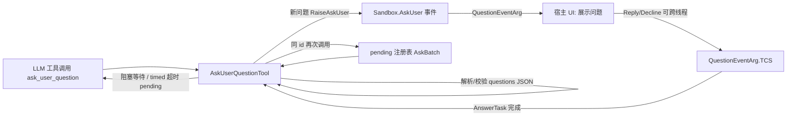

## 产品概述

在 Harness 代理框架中新增 `ask_user_question` 工具：当代理需要确认、选择或缺失信息时，向用户提出一组结构化问题，并把用户的回答回传给模型。

## 核心功能

- 支持一次提出多个问题，每题包含：稳定 id（回答中回显）、问题正文、可选短标题（如 "Confirm"/"Choose Mode"）、可选选项列表（label 必填 + 一句权衡说明；推荐项放首位并在 label 后加 "(Recommended)"）、可选 multi_select（默认 false，允许多选）。
- 默认阻塞行为：工具调用一直等待，直到用户回答（无论多久）。
- `mode: "timed"`：前台最多等待 `timeout` 毫秒；超时返回 pending 结果，问题仍保持可回答，模型可稍后用同一问题 id 再次调用收取答案；`timeout: -1` 表示无限阻塞（与默认一致），`timeout: 0` 表示立即返回 pending（非阻塞轮询）。
- 宿主通过 Sandbox 上的事件接收问题；宿主可同步回答（阻塞模式）或稍后跨线程回答（timed 模式 pending 的基础）。
- 回答按问题 id 逐条回显（选项 label 或自由文本；多选为多个 label）。
- 用户拒答/关闭问题时有明确的 declined 反馈；会话无用户通道时立即报错而非挂起。
- 附带离线确定性自测（解析、阻塞、timed 超时与答案回收、无通道、decline、多选、幂等重问）。

## Tech Stack

- 语言/框架：VB.NET（.NET 10，`Harness/Harness.vbproj`，net10.0），不引入新依赖
- 复用：sciBASIC JSON（`LenientJsonParser.ParseJSON`，与 `MultiEditTool` 一致）、`Microsoft.VisualBasic.CommandLine.Reflection`（`Description`/`ExportAPI`/`Argument` 属性）、Ollama `LLMClient` 工具注册机制、`System.Threading.Tasks.TaskCompletionSource`

## Implementation Approach

- **放置与命名**：新工具放 `Harness\Task\AskUserQuestionTool.vb`，命名空间用 `Tools`——与 `Harness\Job\*.vb`（子文件夹但 `Namespace Tools`）先例及 `Sandbox.vb` 文档“工具本身位于 Harness.Tools 命名空间”一致；在 `Sandbox.ToolRegistry` 增加一行即对模型可见。
- **嵌套参数承载**：`CLRFunction` 只生成扁平 schema 且 `FunctionCall.arguments` 是 `Dictionary(Of String, String)`，故 `questions` 用 JSON 编码字符串传入（同 `multi_edit` 的 `edits`），完整嵌套 schema 写进 `<Argument>` description；解析用 `LenientJsonParser`，容错双重编码、单对象、camelCase（multiSelect），校验缺 id/question、重复 id、options 缺 label。
- **用户通道**：`Sandbox` 新增 `AskUser` 事件 + `QuestionEventArg`（内含 `TaskCompletionSource(Of UserAnswer)`，`RunContinuationsAsynchronously`）。宿主两种用法统一：同步宿主在 handler 返回前调 `Reply`（阻塞模式即通）；异步宿主立即返回、稍后调 `Reply`（timed 模式 pending 的基础）。`RaiseAskUser` 在无订阅者时返回 False，工具立即返回错误而不是永久挂起（对齐 `AskPermission` 无 handler 即拒）。
- **timed 模式的 pending 回收**：工具实例在 `RegisterTo` 时创建一次、跨调用存活，实例内维护 pending 注册表（`Dictionary(Of String, AskBatch)`，AskBatch = Ids + Questions + QuestionEventArg，SyncLock 保护）。同一 id 已回答→直接回已记录答案（幂等，不重弹）；仍 pending→不重复 RaiseEvent，直接等待既有 TCS；新 id→建 batch 抛一次事件；混合调用只对新 id 抛事件，`Task.WhenAll` 合并等待。
- **等待策略**：阻塞或 `timeout=-1` → `Task.WhenAll(...).Wait()` 无限等待；`timeout=N>0` → `.Wait(N)`，超时渲染 pending 文本（列仍开放的 question id 并指引稍后同 id 再调）；`timeout=0` → 立即 pending；`timeout` 做 NaN/Infinity 防御（仿 `ReadTool.ToLineNumber`），除 -1 外负值报错；`mode` 仅接受空/"blocking"/"timed"（仿 `job_start` 的 kind 校验）。
- **返回渲染**：沿用其他工具的 XML 标签风格——已回答：`<answer id=".."><question>..</question><response>..</response></answer>`；pending：`<status>pending</status>` + `<question_ids>` + 指引；declined：`<status>declined</status>` + 指引；错误一律 `Error: ` 前缀。

## Implementation Notes

- 性能：注册表 O(1) 查询；单次 `Wait(timeout)` 无轮询循环；TCS 用 `RunContinuationsAsynchronously` 避免宿主 UI 线程内联 continuation 死锁；已回答 batch 保留（幂等重返），体积极小无需驱逐。
- 日志：不新增日志（与其他工具一致，避免泄露问题内容/PII）。
- 爆炸半径：`Sandbox.vb` 仅做增量改动（1 事件 + 1 Friend 方法 + 1 注册项），不改现有工具行为；新文件均在 `Task\` 与 `test\`；无公开 API 破坏。
- 错误处理：所有解析/校验失败返回可读 `Error:` 文本（含问题序号），工具永不抛异常到 LLM 循环；无宿主订阅立即报错。

## Architecture Design



## Directory Structure

```
g:/LLMs/src/Harness/
├── Task/
│   ├── AskUserQuestionTool.vb   # [NEW] Namespace Tools。工具主体：公有模型 QuestionOption/UserQuestion/UserAnswer；
│   │                            # ask_user_question(questions As String, Optional mode, Optional timeout=300000)；
│   │                            # LenientJsonParser 解析+校验；pending 注册表(AskBatch)与阻塞/timed 等待；XML 渲染。
│   └── QuestionEventArg.vb      # [NEW] Namespace Tools。继承 EventArgs：Questions、AnswerTask、Reply(responses)、Decline()；
│   │                            # 内部 TaskCompletionSource(Of UserAnswer)(RunContinuationsAsynchronously)，同步/异步宿主统一契约。
├── Sandbox.vb                   # [MODIFY] 新增 Public Event AskUser、Friend Function RaiseAskUser(e) As Boolean
│                                 # （无订阅者返回 False），ToolRegistry 增加 ("ask_user_question", GetType(Tools.AskUserQuestionTool))。
└── test/
    ├── AskUserQuestionSelfTest.vb # [NEW] Friend Module，仿 McpSelfTest 的 Check/Fail/RunTest/RunAll；离线确定性断言：
    │                              # 注册可见性、解析容错与各类校验错误、阻塞模式同步 Reply、timed 超时 pending+跨线程延迟
    │                              # Reply+同 id 回收、timeout=-1 延迟答、无通道即错不挂起、Decline、multi_select、幂等不重弹。
    └── Program.vb                 # [MODIFY] 默认流程加入 AskUserQuestionSelfTest.RunAll()，汇总行与 --help 用法扩展。
```

## Key Code Structures

```
' Sandbox 新增（Friend 供同程序集工具调用，宿主只需订阅事件）
Public Event AskUser(sender As Object, e As Tools.QuestionEventArg)
Friend Function RaiseAskUser(e As Tools.QuestionEventArg) As Boolean

' 事件参数：宿主契约
Public Class QuestionEventArg
    Inherits EventArgs
    Public ReadOnly Property Questions As IReadOnlyList(Of UserQuestion)
    Public ReadOnly Property AnswerTask As Task(Of UserAnswer)
    Public Sub Reply(responses As Dictionary(Of String, String))  ' 用户已答，可跨线程
    Public Sub Decline()                                          ' 用户拒答/关闭
End Class

' 工具导出签名（嵌套 schema 写在 questions 的 Argument description 中）
Public Function ask_user_question(questions As String,
                                  Optional mode As String = Nothing,
                                  Optional timeout As Double = 300000) As String
```