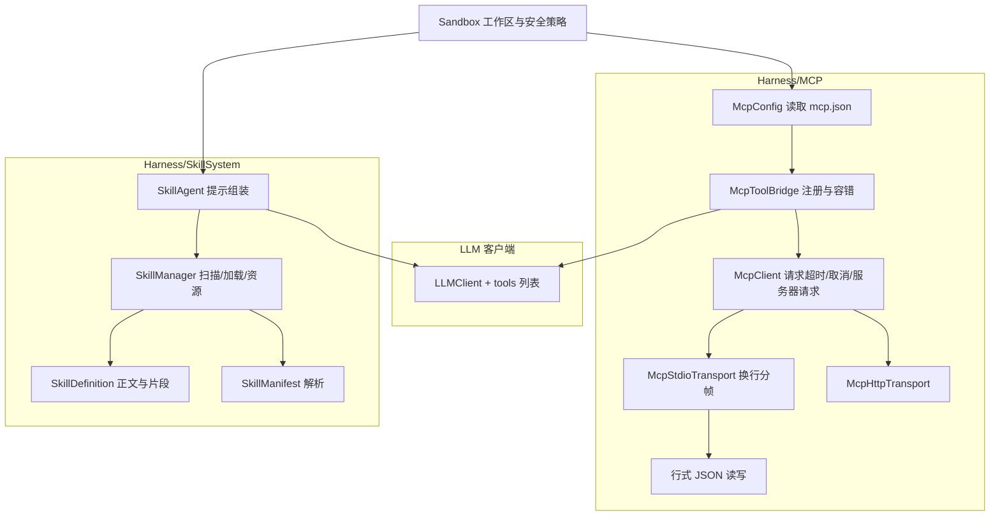

## 产品概述

为 Harness 库补完 MCP 客户端并打通 SkillSystem 与 nature-skills 的兼容性。分两个阶段：P0 修复 MCP（当前 stdio 帧协议与 MCP 规范不兼容，导致与任何标准 MCP 服务器（含 nature-skills 的 FastMCP 学术检索服务器）握手失败），P1 改造 SkillSystem，使其能正确加载 nature-skills 这类以「SKILL.md 路由器 + manifest.yaml + 引用文件」组织的技能包。

## 核心功能

### P0：MCP 客户端可用化

- **stdio 传输按 MCP 规范改为换行分隔 JSON**：每条消息一行、以换行结尾；不再复用 Core 里 LSP 风格的 Content-Length 分帧。
- **请求/响应链路健壮化**：并发安全的消息关联、可配置的响应等待超时、取消时清理未决请求、关闭时让所有未决调用以明确错误结束（不再静默挂死）。
- **正确处理服务器发起的消息**：客户端与服务器的 id 不再撞号；对未知请求回标准 JSON-RPC 错误码，而非静默丢弃。
- **多服务器容错注册**:某一台服务器连接或列举失败时不影响其他服务器；失败信息可被读取。
- **工具命名策略**：默认使用服务器原始工具名（不加前缀），仅当跨服务器出现重名时才自动加服务器名前缀，避免模型按技能文档里的名字调用工具时找不到。
- **配置驱动接入**：支持从工作区下的 mcp.json 读取服务器清单并自动连接注册，同时保留代码直接构造服务器描述符的方式。
- **调用结果呈现完整**：结构化内容、资源链接、非文本内容都不再被丢弃为空串。

### P1：SkillSystem 兼容 nature-skills

- **技能正文完整注入**：技能指令正文（路由协议等）不再因缺少固定小节标题而丢失；manifest 中声明的「必读文件」在预算内自动预载。
- **技能内文件可读**：新增读取技能内文件的工具，支持读取同级的共享技能包文件；越出技能根目录的路径被拒绝。
- **技能元数据解析更健壮**：超长前置元数据不被截断；多行描述在目录清单中折叠为单行，保证路由清单格式稳定。
- **共享包不参与路由**：标记为内部共享的技能不出现在可选技能清单中，但仍可被其他技能引用。
- **资源识别与脚本执行修正**：技能目录下非传统命名的资源目录也能被枚举与识别；脚本参数按多个参数传递，多字节输出不乱码，超时可终止整棵进程树，并支持脚本类型更全。

## 技术栈选择

沿用现有工程，不引入任何新依赖：

- 语言/框架：VB.NET，`net10.0`，`Harness.vbproj`（`RootNamespace=Harness`，SDK 风格通配包含源文件）
- JSON：Core 的 `Microsoft.VisualBasic.MIME.application.json`（`JsonObject`/`JsonArray`/`JsonElement`/`JsonValue`，以及可复用的 `JsonRpc.MakeRequest/MakeNotification/MakeResponse/Str/Int/JsonRpcException`）
- YAML：Core 的 `text.yaml`（`YamlFrontMatterParser`、`YamlParser.Parse/ParseFile`，均已支持块标量）
- LLM 工具注册：`Ollama/LLMClient.AddFunction(func As FunctionModel, f As Func(Of FunctionCall, String))`
- 进程启动：复用本仓库已有的 `Harness/Tools/ProcessLaunch.vb`（UTF-8、超时夹取、输出截断）

## 实现方式

### 关键决策

1. **帧协议就近实现，不污染 Core**：在 `Harness/MCP` 内新增换行分隔 JSON 的读写实现（写：序列化后追加换行并 flush；读：按行读取、跳过空行、逐行反序列化）。Core 的 `JsonRpc.ReadMessageAsync/SendMessageAsync` 保持 LSP 语义不变（其他会话可能依赖）。
2. **id 空间隔离**：客户端请求 id 使用带前缀的字符串序列，避免与服务器发起的请求 id 冲突；响应仅按 id 匹配，带 `method` 的入站消息按服务器请求处理（未知方法回 `-32601`）。
3. **超时与取消都落到未决表**：请求注册进存放 `TaskCompletionSource` 的并发字典，超时或取消时从表中移除并结束该 TCS 并携带可读错误；关闭传输时把剩余未决项统一置异常，杜绝调用方永久等待。
4. **命名冲突只在冲突时消解**：注册前先跨服务器收集全部「服务器 → 工具名」，统计重名；无冲突时用原名注册，有冲突的组统一加服务器前缀，并保留「注册名 → （服务器, 原名）」映射，供后续提示注入使用。
5. **技能正文与 manifest 一起注入但受预算约束**：Layer2 同时提供技能正文、manifest 关键信息（可选轴、按需引用表）与「必读文件」内容；按总字符预算与单文件上限裁剪，超预算时降级为「只列路径 + 提示按需读取」，避免上下文爆炸。
6. **共享技能包用标记而非目录约定**：优先读取前置元数据中的共享标记；无标记时按名称与描述特征兜底识别，路由清单排除但引用仍可解析。
7. **技能内文件访问采用「解析后校验」**：允许相对路径包含 `..`，但解析为绝对路径后必须仍位于技能根目录（即 skills 根）之内，否则拒绝；避免破坏原有严格模式语义（新增独立入口而非放宽旧入口）。

### 性能与可靠性

- 帧读写：单条消息 O(消息长度)；读循环为单线程顺序读取，无额外缓冲复制。
- 未决表：并发字典，请求注册/匹配 O(1)；超时不再需要定时轮询（由等待与取消驱动）。
- 注册阶段：工具枚举与注册对服务器数量线性；仅在需要消解冲突时做一次前缀决策。
- 技能扫描：前置元数据只读到结束标记（带上限），不会因超长文件把整篇读入内存；正文与预载文件按预算裁剪。
- 热点：脚本输出读取与技能正文注入，均设置大小上限，避免长输出或大文件拖垮会话。

### 已知边界（将在代码注释中写明）

- 服务器发起的交互式请求（如采样）本次仅回标准错误，不做实现；服务器能力通知（工具列表变更）不重载工具清单，长会话需重启会话刷新。
- 技能脚本依赖的外部环境（Python/Node 包、浏览器、网络凭据）不由本库管理，只负责正确启动与传参。
- HTTP 传输为次要路径：本次只修正「响应已到达却继续等待流结束」的问题，不新增服务端事件流订阅与会话删除。

## 架构设计



- 工具层（Sandbox 注册与技能代理）→ 桥接层（MCP 工具注册、技能上下文组装）→ 协议/执行层（传输、脚本执行）。
- MCP 与 SkillSystem 通过 LLM 客户端解耦：MCP 工具与技能脚本工具都注册为函数，模型按名字调用。

## 目录结构

```
g:/LLMs/src/Harness/
├── MCP/
│   ├── McpLineFraming.vb        # [NEW] 换行分隔 JSON-RPC 读写助手：WriteMessageAsync（单行 JSON + 换行 + flush）、ReadMessageAsync（按行读、跳过空行、UTF-8 无 BOM 解码、返回 Nothing 表示流结束），以及本地错误响应构造（未知方法 -32601）。不复用 Core 的 Content-Length 分帧。
│   ├── McpStdioTransport.vb     # [MODIFY] 读循环与发送改用 McpLineFraming；类与方法注释去掉 "length-framed" 描述；关闭时先关 stdin、等待进程退出，超时后终止整棵进程树（Kill entireProcessTree），避免 uv/python 孙进程残留；保留 stderr 排空。
│   ├── McpClient.vb             # [MODIFY] 未决请求表改并发字典；请求 id 加客户端前缀；新增可配置的请求超时（等待与超时竞争、超时抛可读异常）；取消令牌注册后能结束等待；入站带 method 的未知请求回 -32601（其他忽略并留日志）；关闭/释放时把剩余未决请求置异常；文档注释同步。
│   ├── McpToolBridge.vb         # [MODIFY] 连接阶段逐服务器容错并收集失败信息（不再一处失败全崩）；注册改为两遍：先收集再决定前缀（默认不加前缀，重名才加），并在实例上暴露「注册名 → 服务器/原名」映射；修正提示列举被调用两次的问题；schema 转换保留数组/对象/枚举/默认值信息（写入参数描述，避免降级为纯字符串）；调用失败信息保持文本化返回。
│   ├── McpModels.vb             # [MODIFY] 调用结果文本化补齐：优先文本、其次结构化内容、再次资源链接/图片/内嵌资源给出可读占位；列表类结果支持游标分页（带上限保护）。
│   ├── McpServerDescriptor.vb   # [MODIFY] 仅注释纠正：stdio 为换行分隔消息，不是长度分帧。
│   └── McpConfig.vb             # [NEW] 配置加载：Load(path) 解析 {"mcpServers":{name:{command,args,env,cwd}|{url,headers,bearerToken}}}（基于 Core JSON），相对 cwd/命令按工作区解析，文件缺失或字段非法时跳过并返回诊断；同时提供默认路径解析（工作区下 .harness/mcp.json，与 Sandbox.ArtifactFolder 一致）。
├── Sandbox.vb                   # [MODIFY] 新增 MCP 接入：可选的 MCP 桥接属性与「按配置加载并注册到客户端」的方法；RegisterTo 在注册本地工具前先尝试加载 .harness/mcp.json 并绑定（无配置则静默跳过，失败只记录不阻断工具注册）；保留纯代码构造桥接的入口；提供显式关闭服务器的方法（宿主退出时调用）。
├── SkillSystem/
│   ├── SkillManifest.vb         # [NEW] manifest 模型与解析：读取 name/version/description、always_load 列表、axes（含 detect/values/default/multi）、references.on_demand 表；基于 Core YamlParser.ParseFile（JsonElement 导航），缺失文件返回空模型而非抛异常。
│   ├── SkillManager.vb          # [MODIFY] 前置元数据读取上限改为「读到结束标记（带硬上限）」避免超长截断；新增技能内相对路径读取入口（解析后必须落在 skills 根内，允许访问同级共享技能包），保留原严格入口；资源枚举改为遍历技能目录下除测试/评测等目录外的全部子目录（保留类型推断），并对文件数设上限。
│   ├── SkillDefinition.vb       # [MODIFY] 提示片段组装：当固定小节别名均未命中时改为注入技能正文（保留已识别小节的结构化输出）；资源引用正则扩展到非标准命名的资源目录，并允许共享技能包相对路径；新增 manifest 字段承载解析结果。
│   ├── SkillMetadata.vb         # [MODIFY] 描述文本存单行（折叠换行与制表符），保留原始描述另存；摘要行对超长描述截断；新增共享技能包标记（来自前置元数据的共享标记，缺失时按名称/描述特征兜底），并提供路由清单过滤。
│   ├── SkillResource.vb         # [MODIFY] 脚本执行改用共享的进程启动约定：参数按多个参数传递（引号感知拆分，不再整体包一层引号）、UTF-8 输出解码、等待超时后终止整棵进程树、关闭标准输入、超时上限提高且可配置；补充脚本类型分派（如 Node 脚本）；保留结果对象结构。
│   └── SkillAgent.vb            # [MODIFY] 构造与执行流程：Layer2 注入改为正文优先 + manifest 必读文件预载（总预算与单文件上限，超限降级为路径清单）；新增「读取技能内文件」函数工具（技能名 + 相对路径，返回文本或明确错误）；路由清单排除共享技能包；执行提示中说明技能内路径与共享技能包的引用方式。
└── ../
    └── test/HarnessSelfTest/    # [NEW] 零依赖自测控制台工程（引用 Harness.vbproj）：既是验证客户端，也是内建 stdio JSON-RPC 存根服务器（--stub-mcp-server 模式，实现 initialize/notifications/initialized/tools/list/tools/call，并可按参数制造超时、重名工具、故意损坏的分帧事件），离线运行、无 python/mcp 包/网络依赖。
```

## 关键代码结构

```
' Harness/MCP/McpLineFraming.vb —— MCP stdio 的帧定义（换行分隔，非 Content-Length）
Friend Module McpLineFraming

    ''' 写出一条消息：单行 JSON + 换行，并 flush。
    Friend Function WriteMessageAsync(stream As Stream, message As JsonElement) As Task

    ''' 读出一条消息：按行读取，跳过空行；流结束返回 Nothing。
    Friend Function ReadMessageAsync(stream As Stream) As Task(Of JsonObject)

    ''' 构造 JSON-RPC 错误响应（如 -32601 method not found）。
    Friend Function MakeErrorResponse(id As JsonElement, code As Integer, message As String) As JsonObject
End Module
```

```
' Harness/MCP/McpConfig.vb —— 默认接入路径
Public Module McpConfig

    ''' 工作区默认配置：<workspace>\.harness\mcp.json
    Public Function DefaultPath(workspace As String) As String

    ''' 读取服务器清单；文件缺失返回空数组，损坏条目跳过并通过 errors 返回说明。
    Public Function Load(path As String, ByRef errors As String()) As McpServerDescriptor()
End Module
```

## 实施注意事项

- **不改 Core**：`JsonRpc`/`YamlFrontMatterParser`/`YamlParser` 保持现状，MCP 的行式分帧只在 `Harness/MCP` 内实现；仅复用其消息构造与扩展方法。
- **命名与反射约束**：新增函数工具的参数描述名必须与参数名逐字一致（框架按名取值）；摘要行保持「- 名称: 描述」单行格式。
- **并发安全**：未决请求表并发访问；注册阶段收集工具信息与写入客户端工具列表串行化，避免同名覆盖。
- **不影响既有行为**：`Sandbox.RegisterTo` 签名与返回保持不变，新增行为都做成可选/静默降级；技能提示组装对未使用 manifest 的旧技能保持可用（正文兜底）。
- **安全**：技能内文件读取与脚本执行都要做「解析后校验」，确保不越出技能根目录；脚本超时要终止整棵进程树。
- **可观测性**：MCP 连接失败、工具重名、技能预载裁剪、脚本超时等都通过既有诊断输出（Debug.WriteLine / Console.Error）留痕，便于排查且不污染模型上下文。
- **改动半径**：Core 与 Ollama 不动；Harness 内新增 3 个文件（行式分帧、配置加载、manifest 模型），修改 6 个既有文件；自测工程独立于发布产物。

## SubAgent

- **code-explorer**
- 用途：在改造 `SkillManager`/`SkillAgent`/`Sandbox` 前，定位它们的全部调用点与注册约定（含 `ToolRegistry`、`RegisterTo`、`SkillMetadata.ToSummaryLine`、`EnumerateResources`、`LoadResourceContent` 的引用位置），确认改动不会遗漏调用方。
- 预期成果：一份引用清单（文件 + 位置 + 调用语义），据此确定每个改动点是否需要同步调整调用方。

## Skill

- **lsp-code-analysis**
- 用途：以语义检索方式核对符号引用，重点确认 `JsonRpc.ReadMessageAsync/SendMessageAsync` 除 MCP 外是否还有调用方（避免误伤 LSP 语义），以及 `McpClient`/`McpToolBridge` 成员改名后的引用完整性。
- 预期成果：可验证的引用列表与调用链结论，保证帧协议改在 MCP 内、Core 行为不变，且重构无漏改。